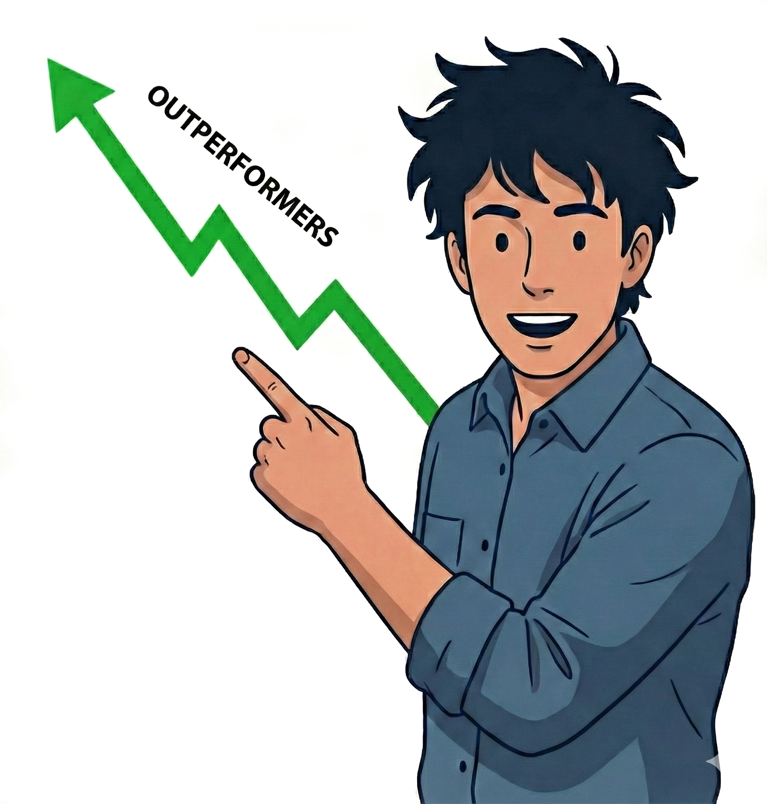





# _On a late Friday_

> The executives gather in the boardroom. The mood is grim; even the air conditioner sounds stressed. On the main screen, Diana is presenting the company’s latest financial report. No one is smiling.

**Diana**: Okay everyone, let's not sugarcoat this. Our marketing campaign has taken a massive hit. We poured money into the biggest YouTubers on the platform, and instead of growth, we’re down 15%. The board wants to shut the influencer program down on Monday.

**Marcus**: It’s not the program's fault, Diana. It’s the market. We worked with the biggest names. You don’t get better reach than that.

**Diana**: The sales team says people are clicking. They just aren't clicking on us. We are burning cash, Marcus.

**Alex**: (Bursting into the room, looking tired as if he hasn't slept all night) Wait! Let’s not kill the program yet. We just need to change who we are paying. It’s not the market, and it’s not the product. It’s the ghosts.

**Marcus**: Ghosts? Alex, please tell me you didn't stay up all night just to crack jokes. And where do you get your data anyway?

**Alex**: I’m serious. I built this on *YouNiverse* — one of the *largest publicly available academic datasets* ever released on YouTube.  
We’re talking **136,000+ English-speaking channels**, **almost 73 million videos**, and multi-year histories of views, subscribers, and audience interaction.

I’ve been staring at the data for the past week. Something with our engagement just wasn't adding up. Those subscribers, those views... for the big channels, they were just an illusion. We need to put our money into **Outperformers**. They will give us the most engagement for every dollar spent.

**Leo**: Ourperformers? What are those? 

## _What are Outperformers_?

  

    <strong>Alex</strong>: While analyzing the YouNiverse data, I found something very interesting. There exists a massive group of channels with low subscriber counts but engagement way above what they should have. And there are plenty of them! If we put our money here, we can get a lot more of these small-to-mid-sized channels, and they will get us way more <strong>Engagement Efficiency</strong>.
     
     
     
    <strong>Marcus: </strong>(Squinting at the screen) Wait. 'Engagement Efficiency'? Is that a real industry term, Alex, or did you just make it up?
  

  

**Alex**: It’s a metric I created because the industry terms were lying to us. Essentially, for every single view, this tells us how many people cared enough to actually do something. The Mega-Stars get views, but nobody touches the keyboard. These Outperformers? Their audience is glued to it.

  
 
    
<b>Engagement Efficiency</b>
     

    <b>Why did I define this?</b>  
    When I started comparing channels in the YouNiverse dataset, it became obvious that raw metrics, views, likes, subscribers, were misleading.  
    Big channels collect views almost automatically, but that doesn’t mean their audience is actually engaged.  
    Smaller channels, on the other hand, often have fewer viewers, but those viewers interact far more intensely.

    I needed a way to compare channels fairly, regardless of size.  
    That’s why I introduced <i>engagement efficiency</i>: a metric that measures how actively a channel’s audience reacts to its content.

      
    <b>Definition:</b> 
    For each channel \(c\), I define engagement efficiency as:

    \[
        E_c = \frac{\text{likes}_c + \text{dislikes}_c + \text{comments}_c}{\text{views}_c}
    \]

    This tells me, per view, how often the audience responds.  
    A higher value means viewers aren’t just passively watching, they’re participating.  
    This was the first clear signal that many small and mid-sized channels were dramatically outperforming the Mega-Stars we paid for.
  

But finding them wasn't as simple as sorting a spreadsheet. Engagement efficiency naturally changes with channel size, smaller channels tend to look “better” simply because they’re small.
To separate real Outperformers from this size effect, I needed a model that captures what level of efficiency is expected at each scale. That’s where the log–log linear regression came in.

  

    
<b>Log-Log Linear Regression Model</b>

    <b>Why a regression model?</b> 
    Engagement scales with channel size, big channels get more interactions simply because they’re big.  
    To spot true Outperformers, I needed to know how much engagement a channel is "expected" to get for its size.

      

    Because views and subscribers span several orders of magnitude, I modeled the relationship in <b>log-log space</b>.

      

    <b>The model:</b> 

    \[
        \log(E_c) = \alpha + \beta \cdot \log(\text{Subscribers}_c) + \epsilon
    \]

     

    <b>Identifying Outperformers:</b> 
    The residuals (\(\epsilon\)) show how far above or below expectation a channel is.  
    Channels with large positive residuals, the top few percent, are the <b>Outperformers</b>.
  

Every dot in the upper cluster represents a channel performing well above its expected engagement for its size, punching above its weight. You can hover over individual points to see the channel name and subscriber count. The background density contours represent the distribution of all other channels, showing where typical performance lies; against this backdrop, it becomes clear that Outperformers are far more prevalent among smaller channels and increasingly rare as subscriber counts grow. Using this distribution, I set a threshold at the top 3% and identified 2,831 Quiet Outperformers.

  <iframe 
      src="assets/plots/outperformers_plot.html"
      style="width:100%; height:100%; border:none;">
  </iframe>

**Leo**: "2,800... that's a goldmine."

**Alex**: I also wanted to see what was happening over time.
I have some of the Outperformers right here, and I analyzed how their engagement efficiency evolves over time from 2005 to 2019.  

  

    
<b>Rolling Reaction Efficiency</b>

    <b>Reaction efficiency:</b> 
    At each time step, engagement efficiency is computed as the ratio between
    accumulated audience reactions and accumulated views:

      

    \[
      E(t) = \frac{\text{reactions}(t)}{\text{views}(t)}
    \]

     

    <b>Smoothing over time:</b> 
    Because uploads and reactions are irregular, I apply a short trailing average
    to this signal to reduce noise caused by upload timing.

      

    All values are computed from data frozen in 2019.
    The rolling average only smooths the visualization and is not used to identify Outperformers.
  



**Alex**: Against their expected baseline, it’s clear they perform much better.
And not just once. Some spike, sure, but many of these channels sustain high efficiency for years.

**Marcus**: (Leaning back, looking less skeptical) Okay, Alex. I see the math. These 'Outperformers' have great engagement stats. But we can't just throw darts at a list of 2,000 random channels. 

**Leo**: Exactly. Even if we believe in Outperformers, we still need to know where to look. What if we accidentally sponsor a flat-earth theorist or a channel that has nothing to do with our audience? We need control.

  
  

    <strong>Leo</strong>: Exactly. Even if we believe in Outperformers, we still need to know where to look. What if we accidentally sponsor a flat-earth theorist or a channel that has nothing to do with our audience? We need control.

     
     
     
    <strong>Alex</strong>: that’s the right question. And it turns out… categories matter more than we thought.
    
     
     
  

## _Where the Outperformers Live and Why It Matters_?

**Alex**:  I started where everyone starts: YouTube’s official category system. There are 15 labels, such as 'Gaming', 'Entertainment' and 'People & Blogs'. They look neat. They’re also terrible. “People & Blogs” is a junk drawer. “Entertainment” mixes movie trailers, late-night clips, and personal vlogs. Two channels in the same category can behave completely differently.

So I ignored the labels YouTube gives us. Instead, I looked at the tags - the actual keywords creators use to describe their own videos. I processed millions of tags from our dataset and used a technique called Latent Dirichlet Allocation.

**Leo**: (Raising an eyebrow) In English, Alex.

**Alex**: Think of it as reverse-engineering the communities. I let the data tell me which videos belong together based on the words they use. Instead of 15 broad buckets, the model discovered 30 distinct micro-communities.

*[Alex clicks next. The screen displays the LDA Topic Cluster Map.]*

<iframe src="assets/plots/cluster_map.html" style="width:100%; height:600px; border:none;"> </iframe>

**Alex**: Once we had these communities, I asked a simple question: Is engagement efficiency the same everywhere? If attention behaved similarly across topics, categories wouldn’t matter.

*[Alex points to a plot on the screen]*

<iframe src="assets/plots/rq2_efficiency_by_topic.html" style="width:850px; height:820px; border:none; align:center; padding-bottom: -100px;"> </iframe>

**Alex**: Statistically, the answer is a clear no. Some communities naturally produce far more engagement per view than others. The baseline is different. An average channel in one community can outperform a strong channel in another, even before we talk about Outperformers.

**Leo**: So the category sets the floor.

**Alex**: Exactly! Outperformers raise you above the floor, but the floor still matters.

 So at this point, you might think the strategy is obvious.
 Just take the communities with the highest baseline engagement and pour the budget into them.

*(He pauses)*

That would work, if performance were the only thing that mattered.
But in the real world, performance attracts attention. And attention attracts competition.
When a community consistently delivers strong engagement, brands notice. Budgets pile in. Creators raise their rates.

**Leo**: So high engagement doesn’t stay cheap for long.

**Alex**: Exactly. Efficiency creates value, but competition sets the price.

That’s why I asked a second question.
If Outperformers were just random accidents, we’d find them scattered evenly across all communities.
In that case, categories wouldn’t constrain us. We could hunt anywhere and expect similar odds.
But that’s not what the data shows.

*(He clicks to show the next slide)*

<iframe src="assets/plots/rq2_outperformer_proportion_by_topic.html" style="width:850px; height:820px; border:none;"> </iframe>

**Alex**: Outperformers cluster. Some communities produce exceptional channels again and again. Others almost never do, no matter how hard creators try.

**Marcus**: So this isn’t just about where engagement is high. It’s about where excellence is repeatable.

**Alex**: Exactly. If the market were already perfectly efficient, these two rankings would line up exactly. The most engaging communities would also be the ones packed with Outperformers.

**Leo**: *(clicking the drop down menu with different sorting criterion)*
But they don’t.

**Alex**: No, and that mismatch is where the strategy lives.
It gives us two paths, not one.

*(He clicked the next slide and a strategy matrix pops up)*

<iframe src="assets/plots/rq2_strategy_matrix.html" style="width:100%; height:650px; border:none;"> </iframe>

**Alex**: First, the *Verified Winners*. Communities that rank high on engagement and are already dense with Outperformers. For example “Game & Gameplay” and “Comedy Vlogs”
These are reliable. Predictable. But crowded, and therefore more expensive.

**Marcus**: And the others? Like “Sports & Music”?

**Alex**: That’s the *Opportunity Gap*. Communities where engagement is strong, but Outperformers are still relatively rare. Less competition. Lower prices. More uncertainty, but far more upside.

*(Alex looks around the room.)*

**Alex**: There isn’t a single “best” strategy here. One path buys us stability. The other buys us leverage. The mistake isn’t choosing one over the other, it’s pretending they’re the same.

*(The room is quiet. This time, thoughtful.)*

# _The Operating System of an Efficient Channel_

**Leo**: Fine. Suppose we stop paying for “big.” What do we actually *look for* when we pick channels?

**Marcus**: Something we can screen for. Something that isn’t vibes.

**Sarah**: And something that doesn’t reward chaos.

**Alex**: Then we stop judging channels by size and start judging them by structure. Since we already stripped out the scale effect earlier with the residual \\(\epsilon_c\\), we can finally ask the real question: what kind of channel design keeps landing above expectation?

**Diana**: More precise.

**Alex**: Three fingerprints. Pace is the median weekly uploads over the last eight weeks. Consistency is how stable that upload rhythm is, scored from 0 to 1. Duration is the channel’s typical video length, and I model it using the logarithm of the duration so extreme outliers don’t dominate.

**Sarah**: *(leaning in)* You’re telling me those three explain why some channels punch above their weight?

**Alex**: I’m telling you they leave patterns you can’t unsee. First, I scanned the terrain with heatmaps. I binned channels by pairs of structural choices and plotted the median residual in each bin. If the relationship is nonlinear, it shows up immediately.

*(Alex clicking to the next slide. A heatmap appears showing the effect of pace, consisdtency and duration on residual for each tier)* 

  <iframe 
      src="assets/plots/rq3_recipe_maps.html"
      style="width:100%; height:100%; border:none; overflow:hidden;"
      scrolling="no">
  </iframe>

**Leo**: *(squinting at the screen)* That’s not random.

**Alex**: No. And it’s remarkably similar across small and mid channels. The strongest signal is duration. Efficiency clusters around moderate to longer typical video length, while channels built around very short typical durations show up again and again in the underperforming zone.

**Diana**: So short videos are bad.

**Alex**: Not universally, but channels built around very short median durations tend to land below expectation more often. The second pattern is the danger zone: high pace combined with low consistency. It’s not volume that hurts you, it’s volume without rhythm. High consistency is broadly associated with better residuals, even when pace is moderate to high.

**Marcus**: *(frowning)* But aren’t these things tangled? The disciplined creators probably do everything right at once.

**Alex**: That’s what I expected too, so I checked before trusting any regression.

  

    
<b>Methodology: correlation matrix and VIF</b>

     
    <b>Correlation matrix:</b> shows simple pairwise relationships between predictors. If two predictors move together strongly, it becomes harder to separate their effects.
      
    <b>VIF (Variance Inflation Factor):</b> checks redundancy in a multivariate sense. It asks whether a predictor can be reconstructed from the others. If it can, its coefficient becomes unstable, standard errors inflate, and interpretation becomes unreliable.
      
    For each predictor \\(x_j\\), regress it on the remaining predictors, compute \\(R_j^2\\), and define:
    \\[
      VIF_j = \frac{1}{1 - R_j^2}
    \\]
    <b>Rule of thumb:</b> VIF near 1 means essentially no redundancy. Larger VIF means stronger overlap and less stable coefficients.
  

*(Alex clicking again. A correlation matrix appers for both tiers and a VIF table below it)*

  <iframe 
      src="assets/plots/rq3_correlation_matrices.html"
      style="width:100%; height:100%; border:none;">
  </iframe>

  VIF by Tier

  <table style="border-collapse:collapse; text-align:center;">
    <thead>
      <tr>
        <th style="border:1px solid #cccccc; padding:12px 20px;">tier</th>
        <th style="border:1px solid #cccccc; padding:12px 20px;">pace (8w)</th>
        <th style="border:1px solid #cccccc; padding:12px 20px;">consistency (8w)</th>
        <th style="border:1px solid #cccccc; padding:12px 20px;">log(duration)</th>
      </tr>
    </thead>
    <tbody>
      <tr>
        <td style="border:1px solid #cccccc; padding:12px 20px;">small</td>
        <td style="border:1px solid #cccccc; padding:12px 20px;">1.01</td>
        <td style="border:1px solid #cccccc; padding:12px 20px;">1.01</td>
        <td style="border:1px solid #cccccc; padding:12px 20px;">1.00</td>
      </tr>
      <tr>
        <td style="border:1px solid #cccccc; padding:12px 20px;">mid</td>
        <td style="border:1px solid #cccccc; padding:12px 20px;">1.01</td>
        <td style="border:1px solid #cccccc; padding:12px 20px;">1.02</td>
        <td style="border:1px solid #cccccc; padding:12px 20px;">1.01</td>
      </tr>
    </tbody>
  </table>

**Alex**: The correlations are tiny, roughly 0.04 to 0.11, and the VIF values are basically 1 in both tiers.

**Diana**: *(nodding)* Good. Then quantify it.

**Alex**: I did, within each tier, holding constant the usual differences across channels, like category, age, and posting intensity. And I used Weighted Least Squares. Channels with many uploads in the window give steadier measurements, while channels with only a few uploads are noisier, so the model gives more influence to the channels with more evidence.

  

    
<b>Methodology: Weighted Least Squares (WLS)</b>

     
    <b>Idea:</b> estimate the same regression, but weight channels by how reliable their residual measurement is in the lookback window.
      
    <b>Weighted regression:</b>
    \\[
      \epsilon_c \;=\; \beta_0 \;+\; \beta_1\,\text{pace8}_c \;+\; \beta_2\,\text{consistency8}_c \;+\; \beta_3\,\log(\text{duration}_c)
      \;+\; \text{Category FE} \;+\; \log(\text{channel age})_c \;+\; \text{videos/day}_c \;+\; u_c
    \\]
     
    <b>Estimation objective:</b>
    \\[
      \min_{\beta}\sum_{c} w_c\left(\epsilon_c - X_c\beta\right)^2
    \\]
    Here \\(w_c\\) increases with how much content we observed for the channel in the window, so higher-volume channels contribute more to the fit.
  

**Leo**: *(half-smiling)* So the “signal” channels speak louder than the “coin flip” channels.

**Alex**: Exactly. First, here are the effect sizes you can feel: moving from a relatively low value to a relatively high value of each factor, translated back into percent change in efficiency.

*(Alex clicking to the next chart)*

  <iframe 
      src="assets/plots/effects.html"
      style="width:100%; height:100%; border:none;">
  </iframe>

**Diana**: *(pointing at the bars)* Duration is huge.

**Alex**: Yes. Increasing typical duration is associated with a large uplift in efficiency in both tiers, and the uncertainty is clearly above zero. Consistency also shows a clear positive lift in both tiers. Pace is near zero in practical terms.

**Alex**: *(clicking again)* And for completeness, here are the coefficients with uncertainty. Same conclusion.

  <iframe 
      src="assets/plots/coefs.html"
      style="width:100%; height:100%; border:none;">
  </iframe>

**Alex**: Pace can look slightly negative and sometimes statistically significant, but the magnitude is tiny next to duration and consistency. And the tier comparison is simple: the point estimates are close and the uncertainty overlaps heavily. I also reran the same setup with shorter and longer windows. The pattern doesn’t move.

  

    
<b>Robustness: 4-week and 12-week windows</b>

     
    <b>4-week window:</b>
    

      <iframe src="assets/plots/effects_4.html" style="width:100%; height:100%; border:none;" scrolling="no"></iframe>
    

    

      <iframe src="assets/plots/coefs_4.html" style="width:100%; height:100%; border:none;" scrolling="no"></iframe>
    

     
    <b>12-week window:</b>
    

      <iframe src="assets/plots/effects_12.html" style="width:100%; height:100%; border:none;" scrolling="no"></iframe>
    

    

      <iframe src="assets/plots/coefs_12.html" style="width:100%; height:100%; border:none;" scrolling="no"></iframe>
    

  

**Diana**: *(closing her laptop halfway)* So what do we do with this?

**Alex**: We stop paying for “activity” and start paying for “structure.” We prioritize creators who show up predictably and whose typical content length supports deeper engagement. And when we see high pace paired with low consistency, we treat it as a warning sign, not a badge of productivity.

**Leo**: *(leaning back)* One sentence.

**Alex**: Efficiency doesn’t come from shouting more. It comes from showing up the same way, with content that gives viewers time to care.



**Diana**: This is all fine in theory, Alex. Engagement is nice. But my stakeholders don't pay bills with 'likes'. They pay with growth. If these channels are so 'efficient' why haven't I heard of them? Do they actually scale, or are they just small, happy little hobbies that will disappear in a year?

**Alex**: I knew you’d be worried about longevity, Diana. So I looked at the history. I tracked the weekly subscriber growth for every single one of these 'Outperformers' over their lifetimes.

# _What is the outperformers's longevity_?

*(Alex clicks a button. A boxplot appears on the screen.)*

  <iframe 
      src="assets/plots/metric1a_unadjusted_growth.html"
      style="width:100%; height:100%; border:none;">
  </iframe>

**Alex**: The results were immediate. In the raw data, our 'Quiet Outperformers' aren't just engaging, they are growing. On average, they gain subscribers 33% faster than the average channel.

  
  

    <strong>Sarah</strong>: (Scoffs, crossing hes arms) Come on, Alex. That’s basic stats. You’re probably just picking channels that are slightly bigger or in booming categories like Gaming. Of course they grow faster; they have an advantage. You're comparing apples to oranges.
     

     
    <strong>Alex</strong>: I thought you might say that. So I ran a Propensity Score Matching (PSM) analysis to fix it.
     
     
     
  

  

    
<b>Methodology: Propensity Score Matching (PSM)</b>

     
    
    
<b>The Challenge: Confounding Bias</b> 
    Directly comparing Outperformers to the general population introduces selection bias. Observed differences in growth could be artifacts of confounding factors, for instance, older channels naturally accumulate more subscribers, and certain categories (e.g., Gaming) have inherently higher activity levels.

    
<b>The Solution: Causal Inference via PSM</b> 
    I employed <b>Propensity Score Matching (PSM)</b> to construct a synthetic control group that is statistically identical to the Outperformer cohort across all observable pre-treatment characteristics.

    
<b>Process:</b>

    <ul>
        <li>
            <b>Propensity Estimation:</b> I modeled the propensity score \( e(X) \), which is the probability of a channel being an Outperformer given its covariates:
              
            $$
            e(X) = P(\text{is_outperformer} = 1 \mid X)
            $$
             
            I estimated this using a regularized <b>Logistic Regression</b>. Continuous covariates (Subscriber Count, Channel Age, Video Volume) were log-transformed to mitigate skew:
              
            $$\text{logit}(e(X)) = \beta_0 + \beta_1 \cdot \log_{10}(\text{subscribers_cc} + 1) + \beta_2 \cdot \log_{10}(\text{channel_age_days} + 1) + \beta_3 \cdot \log_{10}(\text{videos_cc} + 1) + C(\text{category_cc})
$$
             
        </li>
        <li><b>Exact Matching:</b> I enforced an exact match on <b>Content Category</b> to eliminate industry-specific bias (e.g., a "Gaming" Outperformer is only matched with a "Gaming" control).</li>
        <li><b>Nearest Neighbor with Caliper:</b> Within each category, I paired each Outperformer 1:1 with the control unit having the closest propensity score, imposing a strict caliper to ensure high-quality matches.</li>
    </ul>

    
<b>Validation:</b> 
    I verified balance using the <b>Standardized Mean Difference (SMD)</b>, which measures the difference in means relative to the pooled standard deviation:
      
    $$
    \text{SMD} = \frac{\bar{X}_{\text{Treated}} - \bar{X}_{\text{Control}}}{\sqrt{\frac{S_{\text{Treated}}^2 + S_{\text{Control}}^2}{2}}}
    $$
     
    Post-matching, all covariates achieved an \( |\text{SMD}| < 0.1 \), confirming that the groups are statistically comparable. This allows us to attribute differences in growth specifically to <i>Efficiency</i>, rather than size or category.

  

**Alex**: Essentially, I found a 'Twin' for every single Outperformer. Standard channels that were the exact same age, posted the exact same number of videos, and were in the exact same category. The only difference? One was efficient, the other wasn't.

**Diana**: And? Did the 'Twins' look the same?

**Alex**: No. And that’s where it gets interesting. I built a consolidated dashboard to compare them side-by-side across every key metric.

*(Alex advances the slide. A wide, four-panel dashboard appears, showing Subscriber Gain, View Gain, Stagnation Rate, and Posting Frequency.)*

   <iframe 
      src="assets/plots/rq4_combined_metrics.html"
      style="width:100%; height:100%; border:none;">
  </iframe>

**Alex**: Let's walk through this from left to right. First, look at *Subscriber Gain* in the first column. 'Outperformers' grow their subscriber base significantly faster than their twins, just as we saw in the unmatched plot earlier.

**Marcus**: Wait, but look at the second column. Views. They get fewer views than the control group? That sounds like a bad deal.

**Alex**: It’s actually the *best* deal. Remember, *we pay per impression* (CPM).
The 'Control' channels are chasing viral hits, high views (Column 2) but low subscriber conversion (Column 1). We pay for those views, but they don't stick.

**Diana**: (Leaning in) Okay, so they convert better. But are they stable?

**Alex**: That's the second half of the dashboard. 

**Sarah**: Wait, look at the third column. *Stagnation Rate*. The Outperformers have more weeks with zero growth than the control group? That looks like instability to me.

**Alex**: It’s not instability, Sarah. It’s *organic behavior*. Low stagnation in the Control group usually means they are getting a constant, passive trickle of views from the algorithm. The Outperformers grow in *bursts*. They post, the community rushes in, they grow, and then it goes quiet until the next video. They aren't riding an algorithmic wave; they are driving their own traffic.

**Diana**: So they own their audience, instead of renting it from YouTube's homepage.

**Alex**: Exactly. And look at the final column: Posting Frequency. The median Outperformer shows up to work more frequently (1.38 videos/week) than the typical channel (0.98 videos/week). They are disciplined, not lucky.

**Sarah**: So fewer viral spikes, but more consistent daily work?

**Alex**: Exactly. Consistent, high-efficiency work.

**Diana**: Okay, they work hard. But does that work actually pay off over time? Or are they just running on a treadmill?

**Alex**: It pays off. But not immediately. Because they rely on community rather than viral hits, their growth needs time to compound.

*(Alex clicks a final button. A line graph appears, tracking two diverging paths over time.)*

<iframe
src="assets/plots/rq4_growth_trajectory.html"
style="width:100%; height:100%; border:none;">
</iframe>

**Alex**: This is the Median Cumulative Growth over the first three years. It shows the total subscribers gained by a typical channel in each group.

**Marcus**: Hold on. How are you comparing them over time? Some of these channels started in 2015, some in 2017...

**Alex**: I standardized the timeline. The X-axis is *relative time*, not calendar dates. I aligned every single channel to start at their own 'Week 0'. And remember, because of the 'Twin' matching I did earlier, every Outperformer starts this race with the exact same age, size, and video count as their Control counterpart.

**Diana**: So it's a fair start. And what happens next?

**Alex**: For the first two years? Almost nothing. Notice how the lines overlap? Statistically, there is *no difference* between the groups in Year 1 or Year 2. They are grinding, but they aren't winning yet.

**Marcus**: Aha! See? They’re just treading water. No growth. This is pointless.

**Alex**: It’s not stagnation, Marcus. It’s compounding, look at Week 160, about three years in.
The difference between the two groups becomes statistically significant at this moment. 'Outperformer Status' wasn't an inherent advantage they were born with. It was an advantage they earned through 3 years of consistency and engagement.

  

    
<b>Statistical Validation: Mann-Whitney U Test</b>

     
    
    
<b>Hypothesis:</b> 
    I tested the null hypothesis (H0) that the median cumulative subscriber count for Outperformers is less than or equal to that of the Control group at specific time intervals.

    
<b>Results:</b> 
    I performed a one-sided Mann-Whitney U test at three annual checkpoints. The results confirm that the performance gap only becomes statistically meaningful in the long term.

    
    <ul>
        <li><b>Year 1 (Week 52):</b> <i>p</i> = 0.4714 (Not Significant) – No detectable advantage.</li>
        <li><b>Year 2 (Week 104):</b> <i>p</i> = 0.1121 (Not Significant) – The gap begins to widen but could still be due to chance.</li>
        <li><b>Year 3 (Week 160):</b> <i>p</i> = 0.0426 (Significant, <i>p</i> < 0.05) – Reject H0. Outperformers have achieved a statistically significant lead in total audience size.</li>
    </ul>
  

## _The Verdict_

 

**Diana**: (Slowly caps her pen, looking at the screen). So, let me get this straight. You're telling me we've been chasing the wrong metric. The 'Mega-Stars' are playing a viral lottery, chasing massive view counts with low connection. But these 'Quiet Outperformers'...

**Alex**: ...Are **Community Builders**. Exactly. They reject the viral lottery entirely.

**Diana**: Right. They maintain a disciplined schedule, posting more often than average, but they don't get the algorithmic freebies.

**Alex**: Correct. But because they focus on high-efficiency content, every time they *do* post, they convert viewers into loyal fans at an exceptional rate. That is why their long-term subscriber growth is higher, even with fewer views.

**Diana**: So we stop paying for empty 'Eyeballs' and start paying for 'Trust'.

**Alex**: Precisely. We trade reach for loyalty.

**Diana**: That was… genuinely insightful. These Outperformers challenge a lot of our assumptions. Excellent work, Alex, your analysis was precise and thoughtfully argued. We’ll take this under consideration and revisit the decision once we’ve reflected on it. And Alex ... get some sleep.

...

_(In influencer marketing, the loudest numbers aren’t always the smartest ones. Tonight, the board learns to listen for signal instead of noise.)_

 

# _Meet our Team_

 



 

# _Outperformers Hall of Fame_

After traveling to the future in 2025 the outperformers we once knew are now grown, lets hear their success story.



*And many more successful channels ...*

# References and Tools

  <ul style="padding-left:1.5rem; margin:0;">
    <li style="margin-bottom:0.75rem; line-height:1.5;">
      <a href="https://github.com/epfl-dlab/YouNiverse"
         target="_blank"
         rel="noopener noreferrer"
         style="color:#404040; text-decoration:none; font-weight:500; text-decoration: underline;">
        YouNiverse Dataset
      </a>
      — Large-scale YouTube dataset used as the empirical foundation of this analysis, providing channel- and video-level metadata for studying engagement efficiency.
    </li>

    <li style="margin-bottom:0.75rem; line-height:1.5;">
      <a href="https://ai.google.dev/gemini-api"
         target="_blank"
         rel="noopener noreferrer"
         style="color:#404040; text-decoration:none; font-weight:500; text-decoration: underline;">
        Google Gemini Nano Banana Pro
      </a>
      — Used for generating illustrations of characters.
    </li>

    <li style="margin-bottom:0.75rem; line-height:1.5;">
      <a href="https://www.gimp.org/"
         target="_blank"
         rel="noopener noreferrer"
         style="color:#404040; text-decoration:none; font-weight:500; text-decoration: underline;">
        GIMP
      </a>
      — Open-source image editing tool used to refine and compose visual assets included in the story.
    </li>

    <li style="margin-bottom:0.75rem; line-height:1.5;">
      <a href="https://plotly.com/python/"
         target="_blank"
         rel="noopener noreferrer"
         style="color:#404040; text-decoration:none; font-weight:500; text-decoration: underline;">
        Plotly
      </a>
      — Interactive visualization library used to create some of the dynamic plots.
    </li>
  </ul>

